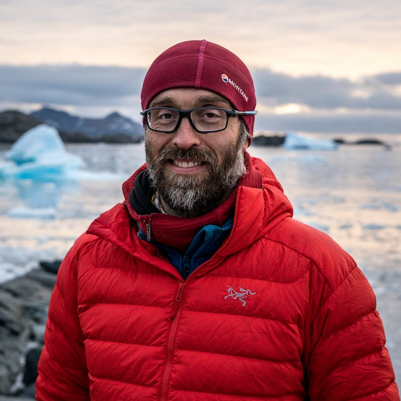

::: {.home-grid}

<!-- Profile card: sticky on desktop, first on phones (pure CSS, see styles.css) -->
```{=html}
<div class="profile-card" role="complementary" aria-label="Profile">
  <picture>
    <source srcset="images/profile.webp" type="image/webp">
    
  </picture>
  <h1 class="profile-name">Rodrigo Gomez-Fell</h1>
  <p class="profile-role">Postdoctoral Fellow</p>
  <p class="profile-affil">Gateway Antarctica<br>University of Canterbury<br>Christchurch, New Zealand</p>
  <ul class="profile-links">
    <li><a href="contact.html" aria-label="Email and contact details" title="Email"><i class="bi bi-envelope-fill" aria-hidden="true"></i></a></li>
    <li><a href="https://github.com/RGFell" aria-label="GitHub profile" title="GitHub"><i class="bi bi-github" aria-hidden="true"></i></a></li>
    <li><a href="https://www.linkedin.com/in/rodrigogomezfell/" aria-label="LinkedIn profile" title="LinkedIn"><i class="bi bi-linkedin" aria-hidden="true"></i></a></li>
    <li><a href="https://scholar.google.com/citations?user=zdY64_kAAAAJ&amp;hl=en" aria-label="Google Scholar profile" title="Google Scholar"><i class="bi bi-mortarboard-fill" aria-hidden="true"></i></a></li>
    <li><a href="https://orcid.org/0000-0002-0391-1323" aria-label="ORCID profile" title="ORCID"><svg class="orcid-icon" viewBox="0 0 24 24" width="20" height="20" aria-hidden="true" focusable="false"><circle cx="12" cy="12" r="12" fill="currentColor"/><text x="12" y="16.2" text-anchor="middle" font-family="Arial, sans-serif" font-weight="700" font-size="11" fill="var(--bs-body-bg, #fff)">iD</text></svg></a></li>
  </ul>
  <a class="btn btn-primary profile-cv" href="files/CV_Rodrigo_Gomez_Fell.pdf"><i class="bi bi-file-earmark-arrow-down" aria-hidden="true"></i> Download CV (PDF)</a>
</div>
```

::: {.home-main}

::: {.home-section .home-intro}
## Earth Observation - Watching Antarctica and the Cryosphere from space {#intro}

I turn large satellite archives into decision-ready measurements of change, using time series analysis and spatial data science alongside machine learning. My main focus is coastal Antarctica, where ice, ocean and sea ice interact at margins likely to drive near-future change, and I apply the same approach to glaciers, rivers and forests across New Zealand.

[Focus areas:]{.focus-label}

::: {.theme-tags}
- Earth observation
- Time series & spatial data science
- Antarctica
- Ice Shelves
- Sea ice
- Synthetic aperture radar (SAR)
- Radioglaciology
- New Zealand
- Patagonia
:::

[Tools:]{.focus-label .tools-label}

::: {.theme-tags .tool-tags}
- Python (xarray, rasterio, geopandas, scikit-learn, others)
- GAMMA SAR
- ISCE
- GMTSAR
- SNAP
- QGIS
- ArcGIS
- Google Earth Engine
:::

<!-- Figure on a white card in both modes (the image has a white background);
     linked to the full-size JPEG because the labels are small on phones. -->
```{=html}
<figure class="home-figure">
  <a class="home-figure-card" href="images/sar-mean-std.jpg" title="Open the full-size image">
    <picture>
      <source srcset="images/sar-mean-std.webp" type="image/webp">
      
    </picture>
  </a>
  <figcaption>Mean and standard deviation of SAR backscatter (dB) across 8 Sentinel-1 scenes over the New Zealand West Coast, November 2016 to January 2017. Water varies most through time; stable land varies least. <span class="image-credit">Contains modified Copernicus Sentinel data (2016–2017).</span></figcaption>
</figure>
```

::: {.home-links}
[More about me](about.qmd) · [Research](research.qmd) · [Projects](projects.qmd)
:::
:::

::: {.home-section}
## Selected publications {#selected-publications}



[View all publications](publications.qmd){.more-link}
:::

::: {.home-section}
## News & highlights {#news}

::: {#news-list}
:::
<!-- Stage 3: add a link to the full News page (news.qmd) here. -->
:::

::: {.home-section}
## Education and positions {#timeline}

::: {.two-timelines}
::: {.timeline-block}
### Positions

```{=html}
<ol class="timeline compact">
  <li class="timeline-item"><span class="timeline-year">2026–</span><div class="timeline-body">Postdoctoral Fellow, Gateway Antarctica, University of Canterbury</div></li>
  <li class="timeline-item"><span class="timeline-year">2023–2026</span><div class="timeline-body">Geospatial Research Scientist, Waterways Centre, University of Canterbury</div></li>
  <li class="timeline-item"><span class="timeline-year">2023</span><div class="timeline-body">Research Assistant, University of Canterbury</div></li>
  <li class="timeline-item"><span class="timeline-year">2020–2023</span><div class="timeline-body">Teaching Assistant (part-time), University of Canterbury</div></li>
  <li class="timeline-item"><span class="timeline-year">2018</span><div class="timeline-body">Researcher, CEQUA research centre, Chile</div></li>
  <li class="timeline-item"><span class="timeline-year">2014–2016</span><div class="timeline-body">Project Manager, CEQUA research centre, Chile</div></li>
</ol>
```
:::

::: {.timeline-block}
### Education

```{=html}
<ol class="timeline compact">
  <li class="timeline-item"><span class="timeline-year">2023</span><div class="timeline-body">PhD, Antarctic Studies, University of Canterbury, New Zealand</div></li>
  <li class="timeline-item"><span class="timeline-year">2018</span><div class="timeline-body">MSc, Oceanography, Universidade Federal do Rio Grande, Brazil</div></li>
  <li class="timeline-item"><span class="timeline-year">2006</span><div class="timeline-body">Industrial Engineering, Pontificia Universidad Católica de Valparaíso, Chile</div></li>
</ol>
```
:::
:::

[Full CV](cv.qmd){.more-link}
:::

:::
:::
