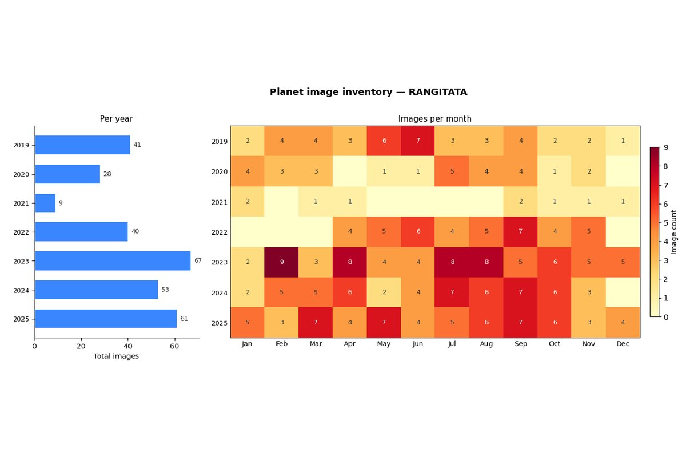
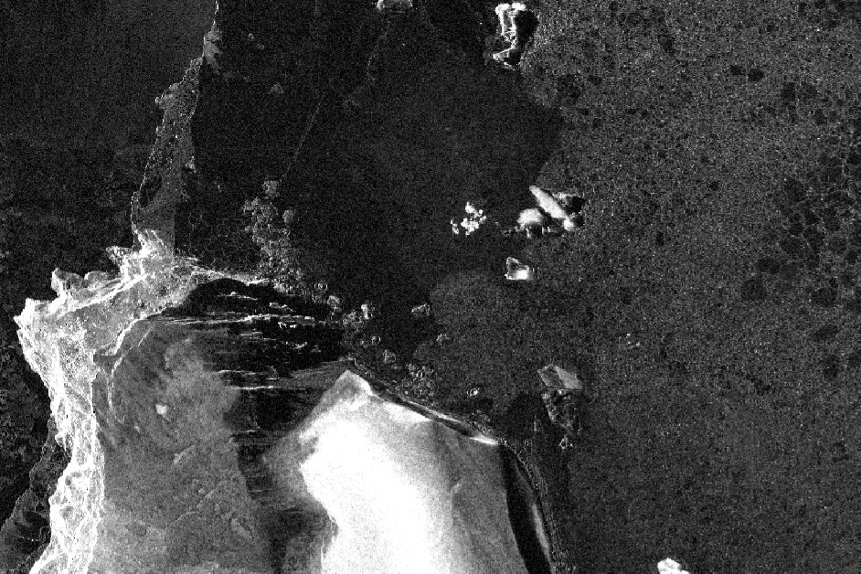
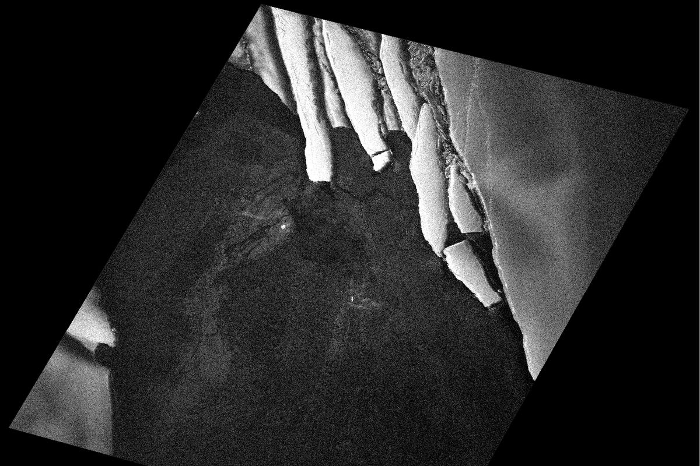
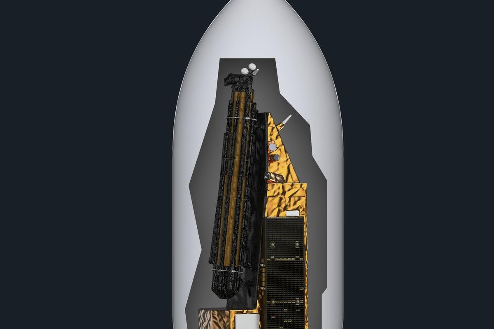
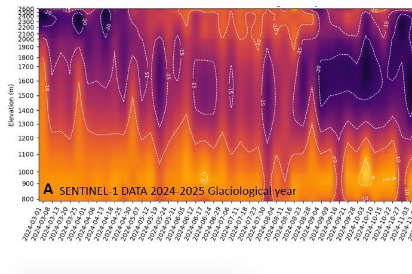
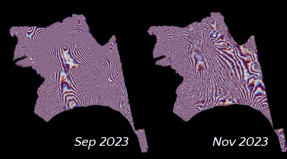
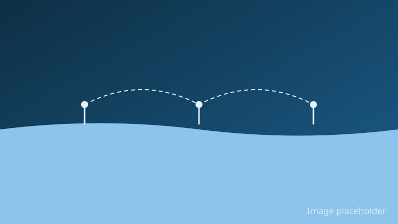
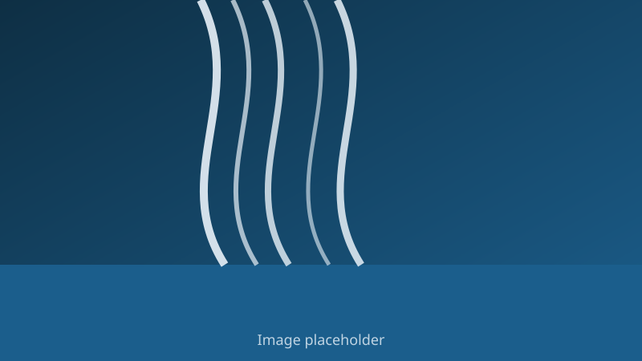

<!-- One section per project, current projects first, newest start year first.
     To add a project, copy a section (see CLAUDE.md). Anchors (#...) are linked from other pages. -->

My current and recent projects, newest first.

## Hāpua dynamics in Canterbury {#hapua}

```{=html}
<figure class="project-figure">
  <picture>
    <source srcset="images/projects/hapua.webp" type="image/webp">
    
  </picture>
</figure>
```

**Years:** 2026

### Summary

Hāpua are lagoons that form where braided rivers meet the sea behind a gravel
barrier. This project maps hāpua in Canterbury and how they change, using a
convolutional neural network (a type of machine learning model) trained on
high-resolution multispectral satellite images. It builds on an MSc project at
the University of Canterbury's Waterways Centre.

### My role

I am a co-principal investigator on this project.

::: {.content-hidden}
<!-- COLLABORATORS: replace the placeholder list below. To publish the section,
     delete this comment and the two ":::" fence lines. Until then Quarto leaves it out. -->
### Collaborators

- Name, institution
- Name, institution
:::

### Funding

Research contract with Environment Canterbury (ECan).

### Related publications

@baker2026hapua (listed on the [Reports](reports.qmd) page)

---

## Penguin colonies from space {#penguin-colonies}

```{=html}
<figure class="project-figure">
  <picture>
    <source srcset="images/projects/penguins.webp" type="image/webp">
    
  </picture>
  <figcaption class="image-credit">Satellite radar (SAR) image by Umbra (cropped), licensed under <a rel="license" href="https://creativecommons.org/licenses/by/4.0/">CC BY 4.0</a>.</figcaption>
</figure>
```

```{=html}
<figure class="project-figure">
  <picture>
    <source srcset="images/projects/umbra-penguins.webp" type="image/webp">
    
  </picture>
  <figcaption class="image-credit">Satellite radar (SAR) image by Umbra (cropped), licensed under <a rel="license" href="https://creativecommons.org/licenses/by/4.0/">CC BY 4.0</a>.</figcaption>
</figure>
```

**Years:** 2026

### Summary

This project uses high-resolution SAR images to detect penguin colonies.
I joined after the project started. I built an automatic workflow that
corrects the radar images for brightness and terrain, and worked on the radar
signal statistics used to tell colonies apart from their surroundings.

### My role

I work on the SAR processing and analysis.

::: {.content-hidden}
<!-- COLLABORATORS: replace the placeholder list below. To publish the section,
     delete this comment and the two ":::" fence lines. Until then Quarto leaves it out. -->
### Collaborators

- Name, institution
- Name, institution
:::

### Related publications

None yet.

---

## BIOMASS calibration and validation over Antarctic ice shelves {#biomass-calval}

```{=html}
<figure class="project-figure">
  <picture>
    <source srcset="images/projects/biomass.webp" type="image/webp">
    
  </picture>
  <figcaption class="image-credit">Image: ESA - J. Huart (<a href="https://www.esa.int/ESA_Multimedia/Terms_and_conditions_of_use_of_images_and_videos_available_on_the_esa_website">ESA Standard Licence</a>)</figcaption>
</figure>
```

**Years:** 2025–2027

### Summary

This project checks measurements from ESA's BIOMASS satellite over Antarctic
ice shelves. Satellite data will be compared with measurements from
phase-sensitive radar (pRES) and airborne SAR to find out how well the satellite
observes the different ice features.

### My role

I am the Principal Investigator on this project.

::: {.content-hidden}
<!-- COLLABORATORS: replace the placeholder list below. To publish the section,
     delete this comment and the two ":::" fence lines. Until then Quarto leaves it out. -->
### Collaborators

- Name, institution
- Name, institution
:::

### Related publications

None yet.

---

## Polarimetric radar imaging of New Zealand glaciers {#rcm-glaciers}

```{=html}
<figure class="project-figure">
  <picture>
    <source srcset="images/projects/rcm-glaciers.webp" type="image/webp">
    
  </picture>
  <figcaption class="image-credit">Contains modified Copernicus Sentinel data (2024).</figcaption>
</figure>
```

**Years:** October 2025 – October 2027

### Summary

The end-of-summer snowline, the lowest point where snow survives the summer,
shows whether a glacier gained or lost ice that year. It has been recorded on
New Zealand glaciers for more than 40 years. This project uses high-resolution
polarimetric radar images from the RADARSAT Constellation Mission, including
over Tasman Glacier, to provide an independent check of this record and to
extend it to other glaciers.

### My role

I am an Associate Investigator on this project.

::: {.content-hidden}
<!-- COLLABORATORS: replace the placeholder list below. To publish the section,
     delete this comment and the two ":::" fence lines. Until then Quarto leaves it out. -->
### Collaborators

- Name, institution
- Name, institution
:::

### Funding

Royal Society Te Apārangi Catalyst Fund.

### Related publications

None yet.

---

## What are the drivers and implications of recent rapid sea ice decline in the Ross Sea? {#ross-sea-ice}

```{=html}
<figure class="project-figure project-figure-native">
  <picture>
    <source srcset="images/projects/ross-sea.webp" type="image/webp">
    
  </picture>
</figure>
```

::: {.content-hidden}
<!-- TODO: data credit for the interferograms (which satellite; Rodrigo to confirm), as
     <figcaption class="image-credit"> inside the figure above. -->
:::

**Years:** October 2025 – June 2027

### Summary

Sea ice in the Ross Sea has declined quickly in recent years. This pilot programme,
part of the Catalyst Strategic NZ-US Joint Antarctic Research Programme, asks what is
driving that decline and what it means. It tests emerging technology for a future
observing network in the Ross Sea, and develops a strategy that combines computer
models, satellite observations and measurements made on the ice and in the ocean.
The work centres on building capability in the McMurdo region.

The pilot is designed to feed a possible third phase with wider deployment of
instruments in the Ross Sea, and to contribute to longer-term international efforts
such as Antarctica InSync and the International Polar Year (IPY). Its results are
relevant to the Ross Sea Marine Protected Area and to New Zealand and US Antarctic
logistics.

### My role

I am a postdoctoral researcher on this project, working on the thickness of McMurdo Sound
fast ice using satellite remote sensing data.

::: {.content-hidden}
<!-- COLLABORATORS: replace the placeholder list below. To publish the section,
     delete this comment and the two ":::" fence lines. Until then Quarto leaves it out. -->
### Collaborators

- Name, institution
- Name, institution
:::

### Related publications

None yet.

---

## SYNCHRONY: Synchronous Southern Ocean Observatory {#synchrony}

{fig-alt="Placeholder illustration: three linked ocean buoys on the sea surface."}

::: {.content-hidden}
<!-- TODO: start year (show as **Years:** YYYY–YYYY once confirmed), host institution,
     and the work package I am on. Also: the list of eight project objectives was not
     provided, so the summary below is based on the project description only. -->
:::

### Summary

SYNCHRONY is an international project that brings together observations, computer
modelling, artificial intelligence and data expertise to improve how we observe and
understand the Southern Ocean and Antarctica. The region is vast and remote, so
the project joins up several ways of observing it rather than relying on any one
of them, and links field observations with models and AI tools so that information
from different sources can be used together. It focuses on keeping long-term
measurements going, on making data easier to find, share and reuse, and on turning
observations into evidence. That evidence is meant to support climate research, the
protection of biodiversity, and decisions about the region.

### My role

I am a postdoctoral researcher on SYNCHRONY for three years.

::: {.content-hidden}
<!-- COLLABORATORS: replace the placeholder list below. To publish the section,
     delete this comment and the two ":::" fence lines. Until then Quarto leaves it out. -->
### Collaborators

- Name, institution
- Name, institution
:::

### Related publications

None yet.

---

## Riverscapes Framework New Zealand {#riverscapes}

{fig-alt="Placeholder illustration: braided river channels running towards the sea."}

**Years:** 2024–2025

### Summary

I led the adaptation of the Riverscapes Framework and its data portal, the
[Riverscapes Data Exchange](https://data.riverscapes.net/), to cover New Zealand as a
national project. It is only the second full-country project on the platform, after the
United States. The New Zealand project covered the country's largest catchments (about 85),
and for seven of them I added a river dynamics component, as part of the braided river work
for the Ministry for the Environment.

### My role

Lead.

::: {.content-hidden}
<!-- COLLABORATORS: replace the placeholder list below. To publish the section,
     delete this comment and the two ":::" fence lines. Until then Quarto leaves it out. -->
### Collaborators

- Name, institution
- Name, institution
:::

### Related publications

@robb2025braided (listed on the [Reports](reports.qmd) page)

---

## References {.unnumbered}

::: {#refs}
:::
