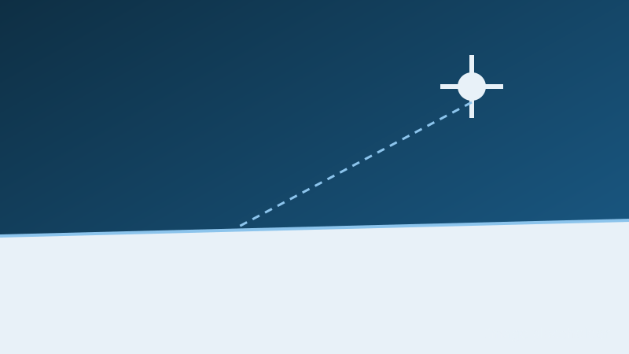

{fig-alt="Placeholder illustration: a satellite above a flat ice shelf."}

**Years:** 2025–2027

## Summary

This project checks measurements from ESA's BIOMASS satellite over Antarctic
ice shelves. Satellite data will be compared with measurements from
phase-sensitive radar (pRES) and airborne SAR to find out how well the satellite
sees the ice.

## Role

Researcher.

::: {.content-hidden}
<!-- COLLABORATORS: replace the placeholder list below. To publish the section,
     delete this comment and the two ":::" fence lines. Until then Quarto leaves it out. -->
## Collaborators

- Name, institution
- Name, institution
:::

## Related publications

None yet.
