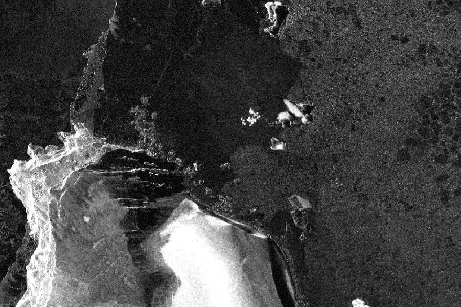

```{=html}
<figure class="project-figure">
  <picture>
    <source srcset="../images/projects/penguins.webp" type="image/webp">
    
  </picture>
</figure>
```

**Years:** 2026

## Summary

This project uses high-resolution SAR images to detect penguin colonies.
I joined after the project started. I built an automatic workflow that
corrects the radar images for brightness and terrain, and worked on the radar
signal statistics used to tell colonies apart from their surroundings.

## My role

I work on the SAR processing and analysis.

::: {.content-hidden}
<!-- COLLABORATORS: replace the placeholder list below. To publish the section,
     delete this comment and the two ":::" fence lines. Until then Quarto leaves it out. -->
## Collaborators

- Name, institution
- Name, institution
:::

## Related publications

None yet.
