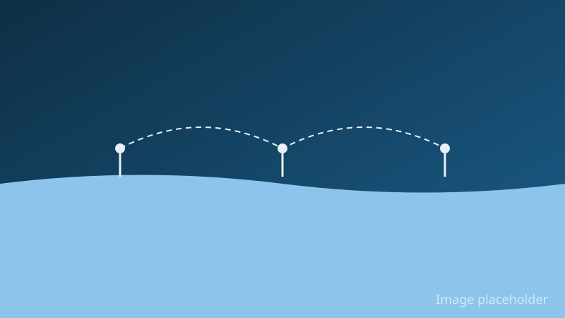

{fig-alt="Placeholder illustration: three linked ocean buoys on the sea surface."}

::: {.content-hidden}
<!-- TODO: start year (show as **Years:** YYYY–YYYY once confirmed), host institution,
     and the work package I am on. Also: the list of eight project objectives was not
     provided, so the summary below is based on the project description only. -->
:::

## Summary

SYNCHRONY is an international project that brings together observations, computer
modelling, artificial intelligence and data expertise to improve how we observe and
understand the Southern Ocean and Antarctica. The region is vast and remote, so
the project joins up several ways of observing it rather than relying on any one
of them, and links field observations with models and AI tools so that information
from different sources can be used together. It focuses on keeping long-term
measurements going, on making data easier to find, share and reuse, and on turning
observations into evidence. That evidence is meant to support climate research, the
protection of biodiversity, and decisions about the region.

## My role

I am a postdoctoral researcher on SYNCHRONY for three years.

::: {.content-hidden}
<!-- COLLABORATORS: replace the placeholder list below. To publish the section,
     delete this comment and the two ":::" fence lines. Until then Quarto leaves it out. -->
## Collaborators

- Name, institution
- Name, institution
:::

## Related publications

None yet.
